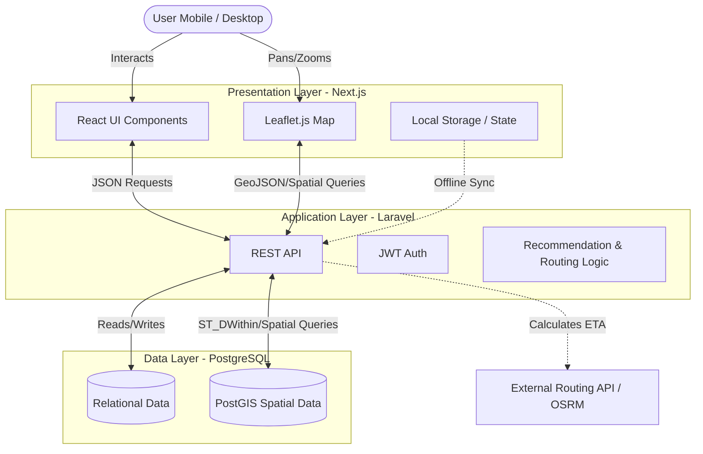

# 1. Architecture Overview

JabarPleasure is a decoupled, Mobile-First WebGIS platform designed to map and recommend public leisure and entertainment destinations across 27 Regencies/Cities in West Java. The system relies on a geospatial database, a backend REST API handling spatial queries and behavioral recommendation logic, and a highly interactive frontend rendering map layers and components.



---

# 2. Architecture Principles

* **Mobile-First WebGIS:** The UI design strictly prioritizes mobile interaction, with maps running fullscreen and components like Bottom Sheets floating above it.
* **Geospatial Precision:** Proximity and spatial calculations form the core of the exploration experience.
* **Offline Resilience:** Critical journey features (e.g., check-ins) must gracefully degrade and rely on local browser storage when network connectivity drops in remote areas.
* **Decoupled & Asynchronous:** The frontend handles UI rendering and map state entirely client-side, while the backend solely serves JSON/GeoJSON data, preventing monolithic rendering bottlenecks.
* **Performance Optimization:** API queries must return in under 3 seconds, and frontend map animations (Interactive Timelapse) must run smoothly at 30fps on mobile browsers.

---

# 3. Technology Stack

## Frontend

* **Framework:** Next.js / React (Confirmed)
* **Styling:** Tailwind CSS (Confirmed)
* **Map Library:** Leaflet.js / React-Leaflet (Confirmed)
* **State Management:** Local Storage for offline data (Confirmed); React Query/Zustand (Recommended)

## Backend

* **Framework:** Laravel / PHP (Confirmed)
* **Architecture:** RESTful API (Confirmed)
* **Authentication:** JWT / Role-Based Access Control (Confirmed)

## Database

* **Database Engine:** PostgreSQL (Confirmed)
* **Spatial Extension:** PostGIS (Confirmed)
* **Data Preparation Tool:** QGIS Desktop (Confirmed)

## Infrastructure & External Services

* **Base Map Tiles:** OpenStreetMap (Confirmed)
* **Routing API:** OSRM / Google Maps API vs Internal pgRouting (Requires Confirmation)
* **Hosting/Deployment:** Vercel for Frontend, VPS for Backend/DB (Recommended)
* **Media Storage:** Local Server Storage (Confirmed)

---

# 4. Repository Structure

The project utilizes a Mono-repo approach to centralize project management and API synchronization.

```text
JabarPleasure/
│
├── fe-jabarpleasure/       # Frontend Next.js application
│   ├── src/
│   │   ├── components/     # Reusable UI (Buttons, Cards, Bottom Sheets)
│   │   ├── features/       # Map, Auth, Itinerary modules
│   │   └── pages/          # Next.js routes
│   └── public/
│
├── be-jabarpleasure/       # Backend Laravel REST API
│   ├── app/
│   │   ├── Http/Controllers/
│   │   └── Models/         # Eloquent models (with PostGIS support)
│   ├── database/
│   │   └── migrations/     # Schema and spatial index migrations
│   └── routes/             # API endpoints
│
├── data_spatial/           # QGIS project files and raw OSM GeoJSON data
└── README.md
```

---

# 5. System Layers

* **Presentation Layer (Frontend):** Manages user interactions, renders the Leaflet map, clusters markers, handles local device states (offline check-ins), and displays data without enforcing complex business logic.
* **Application Layer (Backend):** Handles user authentication, validates media uploads, orchestrates behavioral recommendation algorithms, and manages API routing.
* **Data Access Layer (Database):** Executes raw relational queries and specialized spatial mathematical operations (e.g., `ST_DWithin` for radius searches) securely within PostGIS.

---

# 6. Frontend Architecture

* **Page Structure:** The map is rendered as a fullscreen background (`z-index: 0`), with interactive UI components floating on top.
* **Components:** Must strictly follow the Design System. Use Bottom Sheets instead of standard small map popups to ensure tappability on mobile devices.
* **Map Integration:** Utilizes `react-leaflet`. Server-Side Rendering (SSR) must be disabled for map components using Next.js `next/dynamic` due to Leaflet's reliance on the `window` object.
* **Spatial Rendering:** POI markers **must** implement Marker Clustering to prevent UI clutter and maintain performance when zooming out.
* **Responsive Behavior:** Built Mobile-First with a maximum container width of 480px centered on desktop/tablet screens.

---

# 7. Backend Architecture

* **API Structure:** Stateless REST API returning standardized JSON/GeoJSON formats.
* **Business Logic:** Handles the behavioral weighting for the "Tempat Hiburan untuk Anda" (Personalized Feed) based on onboarding surveys and search history.
* **Authorization:** Middleware strictly segregates Admin routes (Approve/Reject POIs, Analytics) from Registered User routes.
* **Routing Network:** Prepares spatial queries to calculate ETAs and draw polylines between multiple itinerary coordinates.

---

# 8. Database Architecture

* **Main Entities:**
  * **Users:** Stores hashed credentials, roles (Admin/User), and onboarding preference attributes.
  * **Places (POIs):** Stores location details, categories, and PostGIS Geometry points.
  * **Log_Behavior:** Tracks user click history and search frequencies for recommendations.
  * **Journeys & Check-ins:** Records timestamped GPS coordinates, itinerary relations, and media URLs.
* **Spatial Operations:** Relies on PostGIS extensions for core distance calculations rather than application-layer math.

---

# 9. Spatial Data Architecture

* **Coordinate Reference System (CRS):** SRID 4326 (WGS 84) is used for storing geometries in the database.
* **Geometry Types:** Uses `Point` for POIs and destinations, and `Polygon` for the 27 Regency/City administrative boundaries.
* **Proximity Search:** Driven by PostGIS functions (e.g., `ST_DWithin`) to strictly filter destinations within a 5km radius of the user's GPS coordinates.
* **Routing/Polyline Data:** Displays a 4-5px stroke polyline in Primary Blue (`#4941EC`) to visualize routes. The source of routing generation (external API vs pgRouting) requires confirmation.

---

# 10. Authentication & Authorization

* **Authentication Flow:** Token-based flow (JWT) for secure, stateless sessions. Passwords must be hashed.
* **User Roles:**
  * **Visitor:** Unauthenticated read-only access.
  * **User Terdaftar:** Authenticated access to personalized feeds, wishlist, itinerary planning, and check-ins.
  * **Admin:** Full access to spatial data validation (Approve/Reject), media moderation, and analytical dashboards.
* **Unauthorized Access:** Any unauthorized attempt to access Admin routes must be strictly intercepted and return a `403 Forbidden` status.

---

# 11. API Architecture

* **Request/Response Conventions:** Standardized JSON formatting. Spatial data should be served as GeoJSON objects when requested by the frontend map components.
* **Error Format:** Must include specific error messages, especially for authentication failures and media quota exceedances.
* **Authentication Requirements:** Endpoints modifying user data, submitting POIs, or uploading media require valid JWT headers.

---

# 12. State Management

* **Local Component State:** UI toggles, active tabs, and temporary form inputs (React state).
* **Server State:** Fetched POI data, route geometries, and user profiles.
* **Persistent Client Storage:** Uses browser `LocalStorage` to maintain "Check-in" GPS coordinates and timestamps when the device loses internet connection (Offline Mode). This state is automatically synchronized to the backend via a `window.addEventListener('online')` trigger once connectivity is restored.

---

# 13. External Services

* **Mapping Services:** OpenStreetMap is used for extracting raw baseline spatial data and serving frontend base map tiles.
* **Routing Services (TBD):** Project requirements indicate polyline rendering and ETA calculation, but the choice between OSRM, Google Maps API, or internal pgRouting remains an unresolved architectural decision.

---

# 14. File & Media Storage

* **Media Journaling Constraints:** Strict server-side storage limits are enforced. Photos are limited to a maximum of 2MB, and Videos are limited to a maximum of 10MB (approx. 15 seconds) per check-in.
* **Client-Side Compression:** The frontend must utilize image compression libraries to reduce payload size before transmission.
* **Moderation:** Admins have the capability to delete illegal or inappropriate media.

---

# 15. Error Handling & Logging

* **API Error Conventions:** Return `403 Forbidden` for RBAC violations and `400 Bad Request` or `413 Payload Too Large` for media upload violations.
* **Client-Side Handling:** WebGIS components should not crash if routing APIs fail; the itinerary planner must gracefully continue even if crowd-based recommendations are ignored.
* **Logging:** Server must not log JWTs, plain-text passwords, or sensitive location data unnecessarily.

---

# 16. Security Architecture

* **Password Handling:** Cryptographically secure hashing is mandatory.
* **Access Control:** Strict Role-Based Access Control (RBAC) protecting backend administrative endpoints.
* **File Validation:** Strict MIME type and file size validations (2MB image / 10MB video) on both frontend and backend to prevent malicious uploads or server exhaustion.

---

# 17. Performance Considerations

* **Spatial Indexing:** The PostGIS database must implement spatial indexes (GiST) on geometry columns to ensure proximity queries resolve under 3 seconds.
* **Rendering Optimization:** The frontend map **must** use marker clustering. Rendering hundreds of raw markers simultaneously is forbidden as it degrades performance.
* **Map Animation:** The Interactive Timelapse feature must maintain a smooth 30fps rendering on mobile browsers utilizing spatial interpolation.

---

# 18. Testing Strategy

* **Spatial Testing:** Verify the accuracy of coordinates within West Java boundaries and ensure the `ST_DWithin` radius correctly caps at 5km.
* **End-to-End Testing:** Focus on critical journeys, specifically the Offline Mode synchronization for the Check-in feature, and media upload boundary limits (2MB/10MB).
* **UI/UX Testing:** Ensure all map interactions (Bottom Sheets, Check-in buttons) meet the 48x48px tappable area requirement on mobile viewpoints.

---

# 19. Deployment & Environment

* **Build Process:** Mono-repo configuration requires Vercel's root directory to target `fe-jabarpleasure` specifically during deployment to prevent backend source code from interfering with the frontend build.
* **Environment Variables:** Separate environment files for Next.js (e.g., API base URLs) and Laravel (e.g., DB credentials, JWT secrets). Secrets must never be committed.

---

# 20. Dependency Policy

* Do not introduce heavy mapping frameworks if Leaflet.js natively supports the requirement.
* Do not introduce external cloud storage APIs (e.g., AWS S3) unless the local server storage proves insufficient for the Media Journaling limits, subject to budget constraints.

---

# 21. Architecture Decision Records

Major decisions that require ADR documentation moving forward:

* **ADR-001:** Resolution of the open question regarding the routing engine (External API vs. Internal pgRouting).
* **ADR-002:** Mitigation strategy for the Media Journaling storage if server capacity is strained.

---

# 22. Architecture Change Policy

Any modifications to the core PostGIS spatial structure, the transition away from Leaflet.js, or changes to the mobile-first component rules must receive explicit approval from the Project Manager and System Analyst. AI coding agents must not alter these foundational geospatial choices.

---

# 23. Architecture Checklist

Before considering an implementation complete, verify:

* [ ] Coordinate Reference System is strictly using SRID 4326.
* [ ] Proximity queries strictly limit results to a 5km radius.
* [ ] Marker clustering is implemented on all map views.
* [ ] Offline mode fallback successfully caches Check-in data to Local Storage.
* [ ] File upload validators strictly reject photos > 2MB and videos > 10MB.
* [ ] Map popups utilize Bottom Sheets on mobile, not traditional tooltips.
* [ ] RBAC properly intercepts Admin-only routes with a `403` status.

---

## AI Agent Rules

The resulting ARCHITECTURE.md will serve as the technical source of truth.
AI coding agents:

* MUST follow the defined architecture.
* MUST respect confirmed technology constraints (Next.js, Laravel, PostgreSQL, PostGIS, Leaflet.js).
* MUST reuse existing architecture where applicable.
* MUST NOT introduce unnecessary technologies.
* MUST NOT introduce major architectural patterns without justification.
* MUST NOT change database architecture casually (especially PostGIS geometry columns).
* MUST NOT change authentication or authorization architecture without explicit approval.
* MUST NOT introduce new external services without approval (e.g., paid Routing APIs).
* MUST NOT rewrite working architecture without a clear requirement.
* MUST document significant architectural changes.
* MUST flag unresolved architectural decisions instead of guessing (e.g., Routing Strategy).